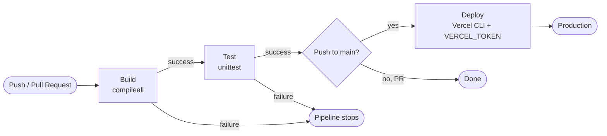

# Simple Python HTTP Server

## Project Description

A minimal web server built only with the Python standard library (no external dependencies).

| Endpoint | Response                                        | Status |
| -------- | ----------------------------------------------- | ------ |
| `/`      | `Welcome`                                       | 200    |
| `/about` | `Simple server built with the standard library` | 200    |
| other    | `Not found`                                     | 404    |

### Tools

- **Python 3.12**: `http.server` (server), `unittest` (tests), `compileall` (build check)
- **GitHub Actions**: CI/CD
- **Vercel**: deployment

### Files

```
main.py                    # server
main_test.py               # unit tests
.github/workflows/ci.yml   # CI/CD workflow
```

### Run Locally

```bash
python main.py                    # server at http://localhost:8000
python -m unittest main_test -v   # tests
```

## CI/CD Process

Workflow file: [`.github/workflows/ci.yml`](.github/workflows/ci.yml).
It runs on every push to `main` and on every pull request. The three stages run in sequence (`needs`), so a failure in one stage prevents the next from running.

1. **Build**: `python -m compileall -q .` checks that the code is syntactically valid and compiles. Python has no separate build step, so this is a build check.
2. **Test**: `python -m unittest main_test -v` runs all three unit tests (`/`, `/about`, 404). The tests start the server on a free port in a separate thread and send real HTTP requests to it.
3. **Deploy**: runs only on a push to `main` (not on pull requests) and only if Test passed. It deploys to production with the Vercel CLI, authenticated by a single GitHub secret: `VERCEL_TOKEN`.

### Setting the Secret

GitHub repository → Settings → Secrets and variables → Actions → New repository secret → name `VERCEL_TOKEN`, value: a token created in Vercel under Account Settings → Tokens.

## Workflow Diagram



## Evidence

### Unit test run

```
$ python -m unittest main_test -v
test_about (main_test.TestServer.test_about) ... ok
test_not_found (main_test.TestServer.test_not_found) ... ok
test_root (main_test.TestServer.test_root) ... ok

----------------------------------------------------------------------
Ran 3 tests in 0.585s

OK
```

### Running application

`http://localhost:8000/` returns `Welcome`.
