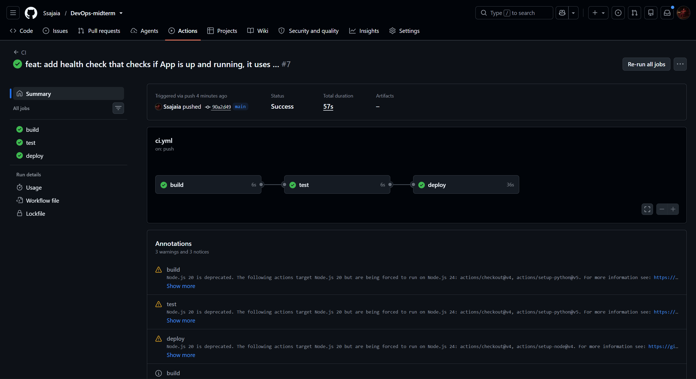
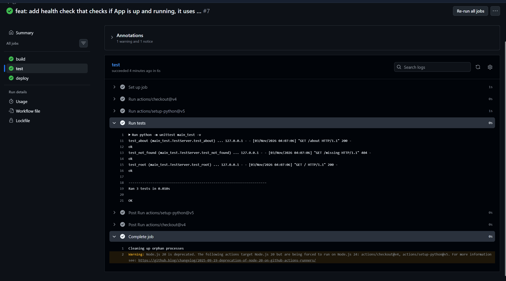

# DevOps Midterm: Simple Python Web Server

## Project Description

A minimal web server written in pure Python (standard library only, no external dependencies). It serves plain-text responses on a few endpoints and is used to demonstrate version control, an automated build/test/deploy pipeline, and health monitoring.

| Endpoint | Response                                        | Status |
| -------- | ----------------------------------------------- | ------ |
| `/`      | `Welcome`                                       | 200    |
| `/about` | `Simple server built with the standard library` | 200    |
| other    | `Not found`                                     | 404    |

**Live application:** `<paste production URL here>`

### Tools

| Purpose           | Tool                                           |
| ----------------- | ---------------------------------------------- |
| Language / server | Python 3.12, `wsgiref` (WSGI app)              |
| Unit tests        | `unittest`                                     |
| Version control   | Git, GitHub (branches: `main`, `dev`)          |
| CI/CD             | GitHub Actions                                 |
| Deployment        | Vercel (Vercel CLI)                            |
| Health monitoring | Bash + `curl`, results written to `health.log` |

### Repository Structure

```
main.py                    # WSGI app and local server
main_test.py               # unit tests
healthcheck.sh             # health check script
health.log                 # health check results
.github/workflows/ci.yml   # CI/CD workflow
docs/                      # screenshots and diagram
```

### Run Locally

```bash
python main.py                    # http://localhost:8000
python -m unittest main_test -v   # run unit tests
```

## Git Workflow

Work is done on the `dev` branch with small, frequent commits and merged into `main` through a pull request. Commit messages follow the `type: description` convention (`feat`, `fix`, `test`, `ci`, `docs`, `chore`, `refactor`).

## CI/CD Process

Workflow file: [`.github/workflows/ci.yml`](.github/workflows/ci.yml). It runs on every push and on every pull request. The three stages run in sequence (`needs`), so a failure in one stage stops the pipeline.

1. **Build**: sets up Python 3.12 and runs `python -m compileall -q .` to check that the code compiles. Python has no separate build step and the project has no dependencies to install, so this is the build check.
2. **Test**: runs `python -m unittest main_test -v`. The three unit tests (`/`, `/about`, 404) start the server on a free port in a separate thread and send real HTTP requests to it.
3. **Deploy**: runs only on a push to `main` (not on pull requests or `dev`) and only if Test passed. It installs the Vercel CLI and deploys to production, authenticated with a single GitHub secret, `VERCEL_TOKEN`.

### Workflow Diagram



_Push or PR triggers Build, then Test. Deploy runs only for pushes to `main`. Any failure stops the pipeline. After deployment the health check verifies the production URL._

## Screenshots

### 1. Successful three-stage GitHub Actions pipeline


_GitHub → Actions: Build, Test and Deploy jobs all completed successfully._

### 2. Successful unit test run



_`python -m unittest main_test -v`: 3 tests ran, all passed (`OK`)._

### 3. Running application


_The application responding with `Welcome` on `/`._

## Monitoring and Health Check

[`healthcheck.sh`](healthcheck.sh) checks whether the deployed application is up and reachable. For each endpoint (`/` and `/about`) it sends a request with `curl`, expects HTTP 200, and appends a timestamped line to [`health.log`](health.log) with the status (`UP` or `DOWN`), HTTP code and response time. A final `SUMMARY` line reports the overall result, and the script exits with code 0 when healthy and 1 otherwise.

```bash
chmod +x healthcheck.sh
./healthcheck.sh https://<production-url>
```

Example `health.log` entries:

```
2026-11-03 08:20:11 UP   https://<production-url>/ -> HTTP 200 in 0.18s
2026-11-03 08:20:11 UP   https://<production-url>/about -> HTTP 200 in 0.12s
2026-11-03 08:20:11 SUMMARY healthy (https://<production-url>)
```
